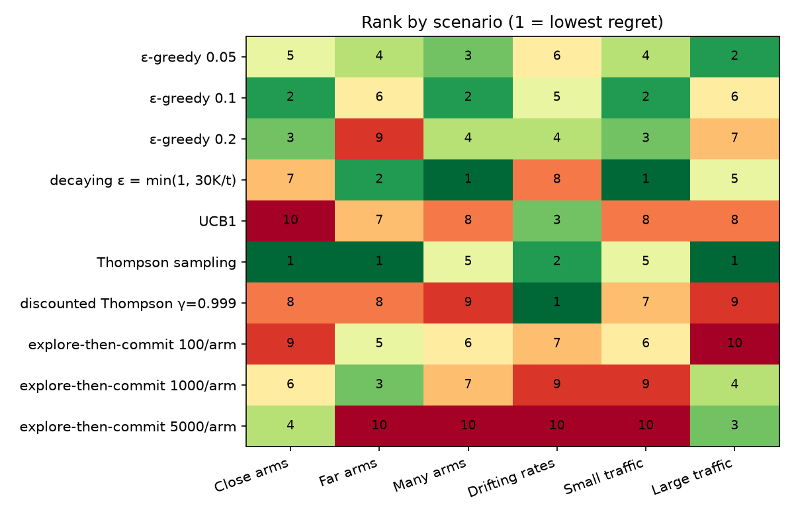

# Bandit Tournament 🏆

A Python simulation study of **10 multi-armed bandit strategies × 6 scenario settings × 200 runs**:

- **ε-greedy:** ε = 0.05, 0.1 and 0.2.
- **Decaying ε.**
- **UCB1.**
- **Thompson sampling,** plus discounted Thompson as a bonus strategy for drift.
- **Explore-then-commit:** 100, 1,000 and 5,000 per arm.

Each setting produces regret-over-time charts with 95% bands and a leaderboard. The findings are in the written report: **[REPORT.md](REPORT.md)**.



## Scenarios

| Key | Setting | Visitors |
|---|---|---|
| `close` | 3 arms at 5.0 / 5.5 / 6.0% | 50,000 |
| `far` | 3 arms at 2 / 5 / 10% | 50,000 |
| `many` | 20 arms between 3% and 7% | 50,000 |
| `drift` | the best arm changes over time | 50,000 |
| `small` / `large` | HW4 upgrade-offer rates (5 / 6.5 / 4%) | 2,000 / 180,000 |

## Run

```
python3 -m venv .venv && .venv/bin/pip install numpy matplotlib
.venv/bin/python tournament.py          # ~22 s on 8 cores (multiprocessing); --runs, --procs
.venv/bin/python test_bandits.py        # 14 checks, ~12 s
```

Outputs:
- `results/leaderboards.md`
- `results/summary.json` (means, CIs, medians, 90th percentiles, pulls per arm)
- `results/curves.npz`
- `figures/regret_<scenario>.png` and `figures/ranks.png`

## How it's built

- **Vectorized across runs.** Strategy state has shape (runs, arms), so one time step advances all 200 runs with a few numpy operations (about 30 µs).
- **Parallel.** The 60 (scenario, strategy) tasks run in a `multiprocessing.Pool`, longest first: about 22 s wall for about 150 s of CPU on 8 processes.
- **Reproducible.** Each task gets its own `SeedSequence(2026)` stream.
- **Expected regret**, as in HW4: it measures choices, not luck.

## Tests (`test_bandits.py`)

- **Regret accounting:** the oracle has zero regret, including under drift, and always showing C costs exactly (0.065 − 0.04) × 180,000 = 4,500.
- **Tie-breaking:** uniform.
- **Explore-then-commit:** exact exploration counts, and regret = 1000 × Σgaps = 130 in every run when the gap is large.
- **Strategy mechanics:**
  - the UCB1 index matches a hand calculation
  - ε-greedy gives the leader 0.9 + 0.1/3 of the pulls
  - the decaying-ε schedule is right
  - discounted Thompson forgets old evidence
- **Reproducibility:** the same seed gives the same results.
- **HW4 3D cross-check:** independent code and seeds reproduce my homework's 200-season results. ε-greedy 0.1 gives 277.4 vs 280.7 (z = −0.41) and Thompson 53.7 vs 54.2 (z = −0.21), and ε-greedy sits above its theoretical floor of 240.
