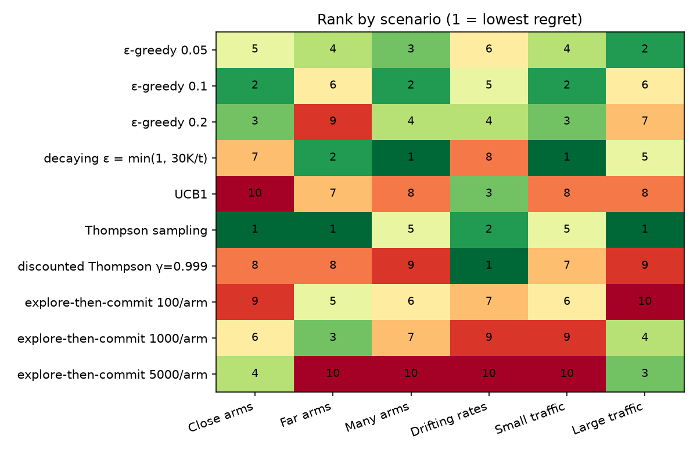
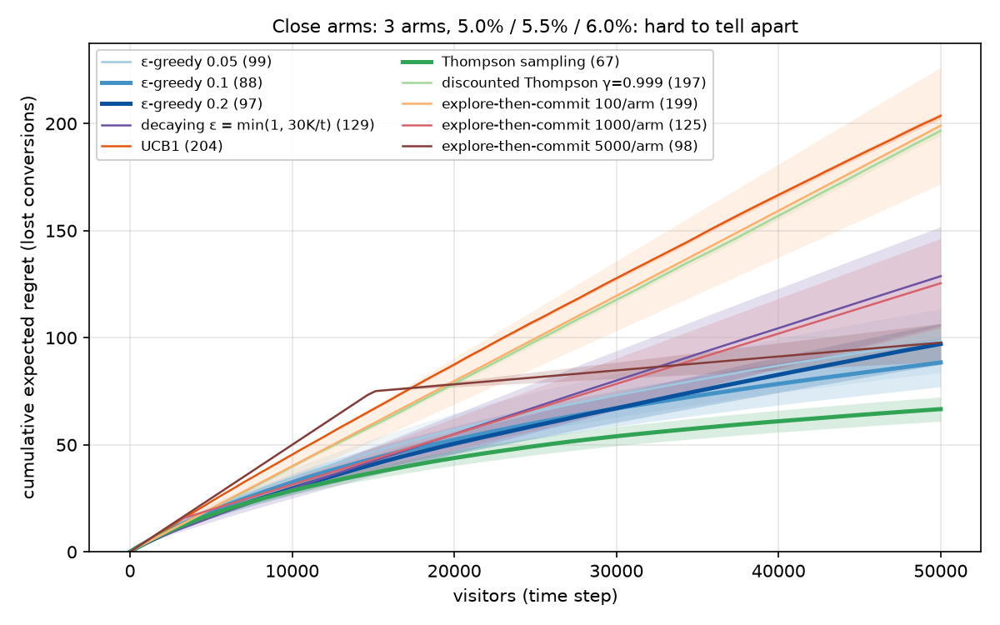
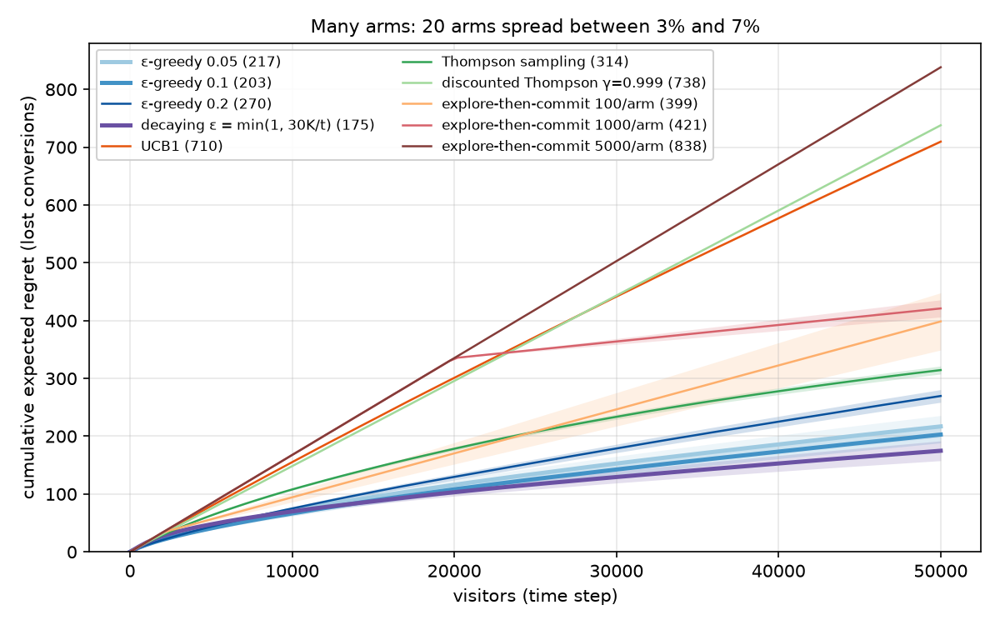
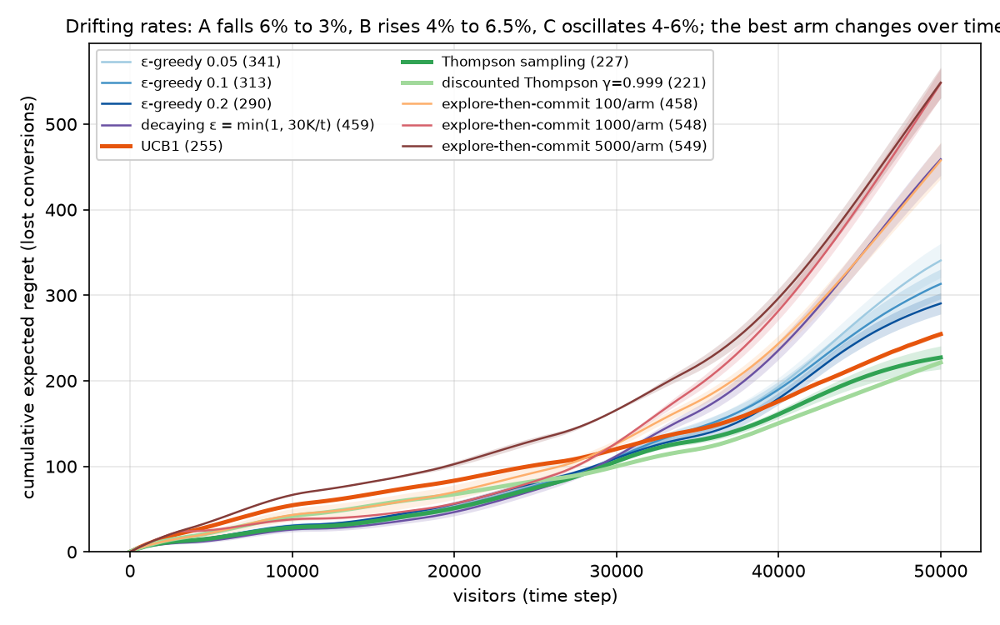

# Bandit Tournament: which strategy wins when, and why

**Setup.** 10 strategies, 6 scenario settings (5 scenarios, with traffic tested at two sizes), and **200 independent runs each**, for 12,000 simulated experiments. Rewards are Bernoulli conversions. **Regret** is expected regret: Σ (best true rate at that moment − true rate of the arm shown), i.e. conversions lost compared with always showing the best version. Full tables are in [`results/leaderboards.md`](results/leaderboards.md). Every number below comes from `results/summary.json`; ± values are 95% CIs over the 200 runs.

## Summary

| Scenario | Winner (mean regret) | Runner-up | Worst |
|---|---|---|---|
| Close arms (5.0 / 5.5 / 6.0%, 50k visitors) | **Thompson** 66.7 ± 5.7 | ε-greedy 0.1 at 88.5 | UCB1 at 203.6 |
| Far arms (2 / 5 / 10%, 50k) | **Thompson** 25.3 ± 1.2 | decaying ε at 37.0 | ETC 5000/arm at 650.0 |
| Many arms (20 arms, 3–7%, 50k) | **decaying ε** 174.9 ± 17 (tied with ε-greedy 0.1) | ε-greedy 0.1 at 202.9 | ETC 5000/arm at 838.3 |
| Drifting rates (50k) | **discounted Thompson** 221.4 ± 2.3 (tied with Thompson) | Thompson at 227.2 | ETC 5000/arm at 548.5 |
| Small traffic (HW4 rates, 2k) | 6-way tie: decaying ε 12.7 … ETC 100/arm 16.2 | | ETC 1000/5000 at 26.7 |
| Large traffic (HW4 rates, 180k) | **Thompson** 59.2 ± 11 | ε-greedy 0.05 at 191.0 | ETC 100/arm at 1,279.9 |

**Thompson sampling wins or ties in 4 of 6 settings and never ranks below 5th.** No strategy wins everywhere. The losers are explained by one idea: **how a strategy decides when to stop exploring.**

## Findings

### 1. Thompson sampling: exploration that fades as certainty grows
Thompson shows a version in proportion to its posterior chance of being best. Once the data separate the arms, the losers almost never win a draw, so exploration fades on its own and the regret curve bends flat (see the close-arms figure). With HW4's rates over 180,000 visitors, it averaged **59 lost upgrades against ε-greedy 0.1's 282**.

This reproduces HW4 3D: `test_bandits.py` gets 53.7 vs HW4's 54.2 and 277.4 vs 280.7 with independent code and seeds.

### 2. Fixed ε pays a tax forever
ε-greedy explores a fixed share ε of the time, uniformly over all K arms, even after it knows the answer. That puts a floor of ε × Σgaps / K × T under its regret, and the results sit right on it:

| Far arms, T = 50,000 | Floor ε·(0.08 + 0.05)/3·T | Observed |
|---|---|---|
| ε = 0.05 | 108 | 135.9 |
| ε = 0.1 | 217 | 230.7 |
| ε = 0.2 | 433 | 439.8 |

On HW4's rates the ε = 0.1 floor is 240 and the observed mean is 281.6. The extra above the floor comes from runs that exploit the wrong arm for a while early on. A smaller ε has a lower floor but a higher risk of that early mistake, which is why ε = 0.05 wins on large traffic and loses on close arms.

### 3. Decaying ε: great median, dangerous tail
ε = min(1, 30K/t) explores heavily at first and then almost stops. When it locks onto the right arm it's nearly perfect: close-arms **median 9.6**, the best of any strategy. When it locks onto the wrong one it never recovers: the **90th percentile is 480.7**, and its mean of 128.7 ranks 7th. On large traffic the median is 12.2 but the mean is 274.2.

It wins on many arms and small traffic, where locking onto *some* good arm early is cheap (next section). The lesson: **look at the distribution, not just the mean.** A strategy with a low median can still be a bad bet for a business that runs one experiment.

### 4. Many arms: a good-enough arm beats the best arm
The 20 arms include six between 6.2% and 7.0%, and the top two are 6.98% and 6.96%. Locking early onto any of the top few costs almost nothing per visitor, so the greedy strategies (decaying ε at 174.9, ε-greedy 0.1 at 202.9) beat Thompson (314.5). Thompson spends its 50,000 visitors carefully telling apart arms that barely differ: its regret grows with K·log T, and with K = 20 that learning phase is long.

With a much longer horizon Thompson would catch up, because the greedy strategies' exploration tax is linear. Within a realistic test window, though, **"pick one of the good ones and move on" is the right instinct.**

### 5. Drift: forgetting is a feature
When the best arm changes mid-test (A falls from 6% to 3% while B rises from 4% to 6.5%), strategies that trust all past data are slow to notice. Discounted Thompson (γ = 0.999) forgets old evidence with a memory of about 1,000 visitors, so it keeps tracking. It's the only strategy with both the lowest mean (221.4) and a tight spread (90th percentile 243, against 367 for plain Thompson). UCB1's never-ending exploration also helps here (3rd place).

The flip side: in every stable scenario, discounted Thompson ranks 7th to 9th, because forgetting means re-exploring arms it had already ruled out. **Use forgetting only if you expect the world to change.**

### 6. UCB1: the right idea, the wrong scale
UCB1's bonus √(2 ln t / n) is designed for rewards anywhere in [0, 1]. With conversion rates around 5%, that bonus is many times larger than the gaps between arms, so UCB1 keeps exploring almost uniformly and its regret grows nearly linearly: last on close arms (203.6) and 8th on large traffic (857.2). Variance-aware versions (UCB-V, KL-UCB) fix this. It's a reminder that **algorithms come with assumptions**, and "provably optimal" bounds can be loose for rare-event data.

### 7. Explore-then-commit: right only if you guessed the gap
ETC's regret is exactly m × Σgaps when it commits correctly. `test_bandits.py` confirms 1000 × (0.08 + 0.05) = 130 in every run on far arms. That makes it a bet on knowing the effect size in advance, which is the same logic as the sample-size formula in HW4 1D:

- **Too short:** 100 per arm on large traffic has a **median of 4 lost upgrades but a mean of 1,280**, because some runs commit to the wrong arm and lose for 180,000 visitors (90th percentile 4,497).
- **Too long:** 5,000 per arm on far arms pays a guaranteed 650 to learn something obvious.
- **About right:** 5,000 per arm on HW4's rates ranks 3rd (200, every run).

This is HW4 3E's trade-off. A fixed test buys a clean, reportable estimate with a confidence interval; adaptive methods earn more during the test but leave the losing arms poorly measured.

### 8. Small traffic: nothing helps much
With 2,000 visitors, the top six strategies are statistically tied (12.7–16.2). There isn't enough data for any method to learn and then profit. ETC 1000 and 5000 per arm simply explore the whole time: 2,000/3 × (0.015 + 0.025) = 26.7, exactly as observed. **If traffic is small, pick a simple method and spend the effort on bigger differences between versions.**

## Recommendations

| Situation | Use |
|---|---|
| Default for conversion tests with steady traffic | **Thompson sampling** |
| Many similar variants, limited time | decaying ε or ε-greedy with a small ε, and accept "good enough" |
| Rates change over time (seasonality, novelty effects) | **discounted Thompson** (or a sliding window), with a memory matched to how fast things change |
| You need a clean estimate and CI for each arm (reporting, pricing decisions) | a fixed-split test sized with the power formula, i.e. explore-then-commit with a properly sized m |
| Very little traffic | anything simple; the method matters less than the effect size |

## Method notes

- **Code:** `bandits.py` holds the strategies and scenarios, vectorized across the 200 runs, so each time step updates all runs at once in numpy. `tournament.py` runs the 60 (scenario, strategy) tasks in a `multiprocessing.Pool`: about 22 s on 8 processes for about 150 s of CPU, a 6.9× speed-up.
- **Seeds:** each task gets its own random stream from `SeedSequence(2026)`, and reruns are byte-identical.
- **Strategy details:**
  - All strategies break ties at random.
  - ε-greedy explores uniformly over all arms, including the leader, as in HW4 3B.
  - UCB1 and the ε strategies try every arm once first; Thompson starts from Beta(1, 1).
- **Bands** in the figures are 95% CIs for the mean regret curve (mean ± 1.96·sd/√200).
- **Drift regret** is measured against the best arm *at each moment*.
